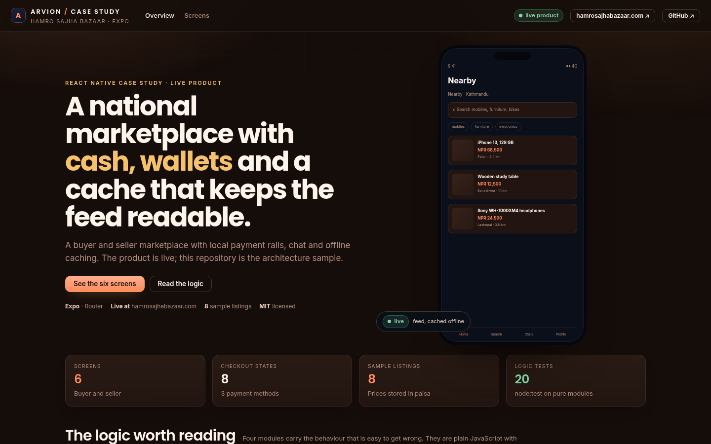
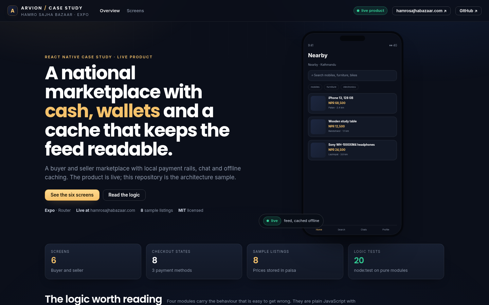

<div align="center">

</div>

<sub>Recorded from the live demo — <a href="docs/demo.mp4">MP4</a> · <a href="docs/screenshot.png">static frame</a></sub>

# Hamro Sajha Bazaar

React Native/Expo case study from a national marketplace that runs in production
at [hamrosajhabazaar.com](https://hamrosajhabazaar.com). Buyers browse listings,
chat with sellers and pay with eSewa, Khalti or cash on delivery; sellers get a
dashboard and a settlement breakdown. This repository is the architecture sample,
not the store build.

[**Open the live case study**](https://arvion-technology.github.io/labs/demos/bazaar-app/) · [MIT](LICENSE)

---

A marketplace is mostly state management: a checkout that has to survive a failed
wallet payment, money that must never touch a floating-point number, filters that
have to keep working while the network is down, and a feed that should not blank
out when a request is in flight. Those four pieces are the source in `src/`, and
they are tested with `node --test`. The Expo Router screens in `app/` are a
representative slice of the product, not the published binary.

The product is live. No App Store or Play Store link is claimed here because this
repository does not ship the store build.

## What it does

- **A listing feed** with query, category, price and distance filters, five
  explicit sort orders and facet counts — all computed locally against a cache.
- **Buyer and seller screens** — feed, listing detail, checkout, chat, seller
  dashboard and seller orders, written as Expo Router screens with React Native
  primitives.
- **An eight-state checkout** — cart, address, review, payment, processing, paid
  plus the failed and cancelled branches. Failed payments retry without losing
  the cart.
- **Three local payment methods** — eSewa, Khalti and cash on delivery. COD
  changes the guard: it only settles after delivery is confirmed.
- **Money in paisa** — integer amounts from cart to settlement, one display
  formatter, a platform fee with a floor, distance-based delivery and an explicit
  seller/platform split.
- **A stale-while-refresh cache** — fresh, stale and missing reads are distinct
  states, so the feed shows cached listings instead of a spinner.
- **A case-study site** — a phone-frame gallery of the six screens, the checkout
  state diagram, a computed quote breakdown and the seller settlement view.

## Screenshots

| Overview | Six screens |
| --- | --- |
|  |  |

## Architecture

```text
29-bazaar-app/
├── app/                        Expo Router screens (TypeScript)
│   ├── _layout.tsx             stack, header and theme
│   ├── index.tsx               feed with filters
│   ├── listing/[id].tsx        listing detail
│   ├── checkout.tsx            checkout driven by src/checkout.js
│   ├── chat/[id].tsx           buyer-seller thread
│   └── seller.tsx              dashboard and settlement
├── components/
│   └── listing-card.tsx
├── src/                        pure logic the node:test suite imports
│   ├── checkout.js             state machine + guards
│   ├── money.js                paisa arithmetic, fees, quote, settlement
│   ├── filters.js              query/category/price/distance + sorts
│   ├── cache.js                TTL cache with stale-while-refresh
│   ├── catalog.js              sample listings, screens, seller orders
│   └── theme.ts                colour tokens for the Expo screens
├── test/logic.test.js          20 node:test cases
├── demo/                       static case study site
├── docs/                       screenshots
└── scripts/                    serve, shot, static checks
```

The logic modules are plain ES modules with JSDoc types, not compiled
TypeScript. That is a deliberate trade-off: `node --test` runs on a fresh clone
with no build step, and the same modules are imported by the TypeScript screens.
The screen layer is typed; the logic layer is tested.

## Quickstart

```bash
git clone https://github.com/arvion-technology/bazaar-app.git
cd bazaar-app
npm test          # 20 tests, no dependencies, Node 20+
npm run demo      # http://localhost:4173/demo/
```

To run the Expo app you need the Expo toolchain and a device or simulator:

```bash
npm install
npx expo start
```

The `app/` folder assumes `expo-router` and React Native as peer dependencies.
They are not installed in this repository because the static demo and the logic
tests must run with no `npm install` at all.

## How it works

**Checkout is a state machine with guards.** `advance()` first checks that the
edge exists, then that its guard passes: a review needs a non-empty address and a
positive total, a payment step needs a valid method, and COD only reaches `paid`
when `deliveryConfirmed` is true. The guard returns a reason string, so a disabled
button can explain itself. `advance()` merges the patch before running the guard —
otherwise confirming delivery and marking the order paid could not happen in one
action.

**Money never becomes a float.** Every amount is an integer in paisa.
`formatNPR()` is the only function that divides by 100, and it does so at display
time. The 2% platform fee has a NPR 2 floor (checked at the boundary where it
matters, a small order), delivery is NPR 80 plus NPR 25 per kilometre, and
`settlement()` asserts that seller plus platform equals the buyer's total. The
tests cover the rupee boundary, negative formatting and non-integer rejection.

**Filters are local and explicit.** `applyFilters()` composes query matching (every
term, case and accent folded), category, price and distance, then applies one of
five named sorts. Unknown categories and sorts throw instead of silently
returning nothing. Facet counts use the same query matcher, so the numbers above
the filters always match the list below them.

**The cache exposes staleness.** `createCache()` has `get()` for fresh-only and
`read()` for the app path: fresh value, else stale value tagged with its age, else
empty. `cachedFetch()` returns cached content immediately and refreshes in the
background. This is why the feed does not flash a spinner over content the user
can already read.

**Two audiences, not one page duplicated.** The seller dashboard is about orders
and payouts, not listings. The chart of the settlement is computed with the same
`quote()`/`settlement()` pair the buyer's checkout uses, so the fee shown to the
seller is the fee the buyer paid.

## Tests

```bash
npm test
```

Twenty cases on `node:test`:

| Area | What is checked |
| --- | --- |
| checkout | eight states, illegal edges, guards with reasons, eSewa/Khalti flow, COD delivery guard, failed-payment retry, immutable history |
| money | integer paisa, display formatting, fee floor, distance fee, quote lines, settlement balance, price input parsing |
| filters | composed filters, multi-term query, all sorts, facet counts, suggestions, unknown category/sort |
| cache | fresh vs stale vs missing, TTL expiry, invalidation, background refresh |
| data | eight listings, six screens, role counts, product status honesty |

The static demo has its own asset and placeholder check:

```bash
node scripts/serve-check.mjs
```

## Limitations

- This is not the published app. The Expo screens are a representative slice;
  there is no store binary or store link in this repository.
- There is no backend, no real payment integration and no authentication. The
  checkout simulates the wallet hand-off and the cash-on-delivery confirmation.
- The logic layer is JavaScript with JSDoc types. A production app would likely
  compile TypeScript for the same modules; the contracts are the same.
- Images in the phone mocks are CSS placeholders. The real marketplace loads
  seller photography, which is a different performance problem.
- Chat is local state. Delivery receipts, typing state and moderation are not
  modelled.

## Project layout

```text
29-bazaar-app/
├── app/                    Expo Router screens
├── components/             shared React Native components
├── src/                    pure logic + sample data
├── test/                   node:test suite
├── demo/                   static case study site
├── docs/                   screenshots
└── scripts/                serve, shot, static checks
```

## Credits

Built by [Arvion Technologies](https://arviontech.net) in Kathmandu. Hamro Sajha
Bazaar is a live product of ours; we published the sample because the money and
checkout layers are where marketplaces usually break. MIT licensed.
